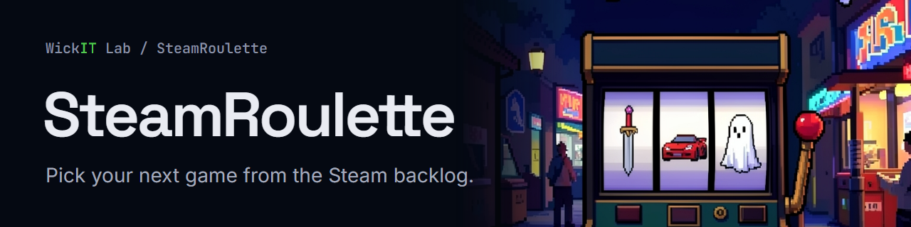

<p align="center">
  
</p>

**Can't decide what to play? Let your Steam backlog pick for you.**

Steam Roulette is a small Windows desktop app that reads your Steam library and randomly chooses a game to play, with filters that fit a backlog: installed-only, never-played, "under N hours", "nothing I've touched in the last N days", genre, category, Metacritic score and unfinished achievements. A weighted mode tilts the roll toward games you have barely opened, and one click launches the pick straight into Steam. It reads your full owned library, with playtime, when you add a Steam Web API key, and falls back to parsing your installed games locally when you do not.

Built with C# and .NET 10 (WPF). A pure `Core` library holds all the logic (Steam file parsing, Web API and store clients, the roulette) with unit tests; the WPF project is a thin UI on top. There is no installer and no tagged release yet: you run it from source.

## Contents

- [Tech stack](#tech-stack)
- [Prerequisites](#prerequisites)
- [Getting started](#getting-started)
- [Features (built)](#features-built)
- [Configuration and local data](#configuration-and-local-data)
- [How it works](#how-it-works)
- [Security](#security)
- [What's not yet built](#whats-not-yet-built)
- [License](#license)

## Tech stack

| Layer | Technology |
| --- | --- |
| Language / runtime | C# on .NET 10 |
| UI | WPF (`net10.0-windows`), Windows only |
| Core library | Dependency-free Steam VDF/ACF parser, Steam Web API and store clients, JSON disk cache |
| Tests | xUnit |
| CI | GitHub Actions on `windows-latest`: restore, build, test, security scan, monthly Dependabot |

## Prerequisites

- Windows (WPF is Windows-only)
- The [.NET 10 SDK](https://dotnet.microsoft.com/download)
- Steam installed, for the installed-games source and for launching a pick
- Optional, for your whole owned library with playtime and achievement progress: a Steam Web API key from <https://steamcommunity.com/dev/apikey> and your 64-bit SteamID from <https://steamid.io>

## Getting started

1. Clone the repo:

   ```sh
   git clone https://github.com/w1ck3ds0d4/SteamRoulette.git
   cd SteamRoulette
   ```

2. Launch the app:

   ```sh
   dotnet run --project src/SteamRoulette.App
   ```

3. On first run it lists your installed games. To roulette your whole owned library, open Settings and enter your Steam Web API key and 64-bit SteamID.

4. Optionally run the unit tests:

   ```sh
   dotnet test
   ```

## Features (built)

### Library loading

- **Web API source**: the full owned-games list with playtime and last-played, via `IPlayerService/GetOwnedGames` (needs a free Web API key and your SteamID).
- **Local source**: installed games parsed from `libraryfolders.vdf` and `appmanifest_*.acf` across every Steam library folder. No key needed.
- **Merged**: uses the Web API when configured (marking which titles are installed from local data), and falls back to local-only when it is not configured or the API call fails.

### The roulette

- **Surprise me**: a random pick from whatever matches your current filters.
- **Filters**: installed only, unplayed only, max hours, hide games played in the last N days, name search, genre, Steam category (Single-player, Co-op and so on), minimum Metacritic score, has achievements, unfinished achievements.
- **Favor my backlog**: a weighted draw that biases toward games with little playtime, so the pile you never touch wins more often.
- **Launch in Steam**: fires `steam://run/<appid>` for the chosen game. Double-click any game in the list to make it the pick.
- **Reload**: re-reads the library on demand.

### Game details

- A stats panel for the rolled game shows playtime, achievement progress, release date, Metacritic score, Steam user rating and a short description.
- Store metadata, achievement progress and review summaries are fetched in the background from Steam, rate-limited and cached on disk.
- **Malware check**: hashes the game's likely main executable with SHA-256 locally and opens its VirusTotal report in your browser. Only the hash leaves your machine; the file is not uploaded.

## Configuration and local data

- `%APPDATA%\SteamRoulette\settings.json` holds your Web API key, SteamID and last-used filters.
- `%LOCALAPPDATA%\SteamRoulette\cache` holds the enrichment cache.

## How it works

```
src/SteamRoulette.Core/    # logic, no UI
src/SteamRoulette.App/     # WPF desktop app
tests/SteamRoulette.Tests/ # xUnit tests
```

- `SteamRoulette.Core`:
  - `Steam/VdfParser`: minimal Valve KeyValues (VDF/ACF) parser.
  - `Steam/SteamPaths`: locates Steam (registry and defaults) and enumerates library folders.
  - `Steam/LocalLibrarySource`, `WebApiLibrarySource` and `LibraryLoader`: the three load paths.
  - `Steam/GameEnricher`, `SteamStoreClient`, `AchievementsClient`, `JsonDiskCache` and `RateLimiter`: store metadata, achievements and reviews, cached and throttled.
  - `Roulette/GameRoulette`: filtering and flat or weighted random pick.
  - `Steam/GameLauncher`: `steam://` launch.
  - `Steam/MalwareCheck`: local hashing and the VirusTotal link.
- `SteamRoulette.App`: the WPF UI (`MainViewModel`, `MainWindow`, `SettingsWindow`).
- `SteamRoulette.Tests`: xUnit tests for the parser, the roulette, filters, enrichment parsing, the disk cache and the malware check.

## Security

Steam Roulette runs as the logged-in user with no elevation, no driver and no background service, and has no server component. The Steam Web API key is optional and is stored in plain JSON in `settings.json`, so anyone with access to that Windows profile can read it. It is scoped to public player data, not your Steam password. The built executable is not code-signed, so Windows SmartScreen may warn on first run. See [SECURITY.md](SECURITY.md) for what the code touches and how to report a vulnerability through GitHub's private vulnerability reporting.

## What's not yet built

- **Achievement manager**: listing and editing a game's achievements and stats through the Steamworks SDK (`ISteamUserStats`) for games you own, with Steam running. It talks to your running Steam client and sits in a gray area of Steam's Subscriber Agreement, so it would be kept separate and opt-in. Parked.
- **Backlog and achievement cross-over**: "pick a game I'm one achievement away from 100%-ing". Parked.
- **Game art polish**: cached capsule art and a spin animation on the pick. Parked.
- An installer or published releases. The project is in maintenance mode; see [ROADMAP.md](ROADMAP.md).

## License

This project is licensed under:

- [Proprietary](LICENSE) - all rights reserved by WickIT Lab. The source is public to read; any other use needs written permission (support@wickitlab.com).
